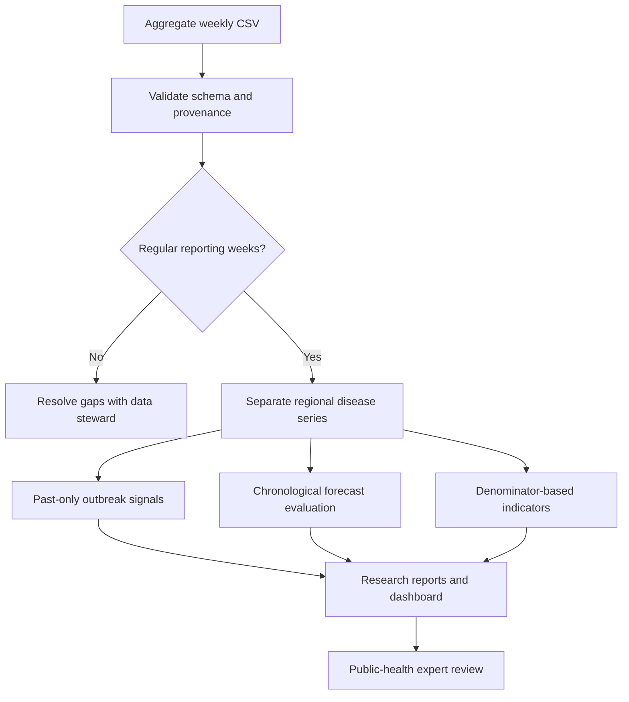

# PublicHealth Surveillance AI

An auditable Python research platform for aggregate disease surveillance,
prospective outbreak signals, population indicators, vaccination coverage,
healthcare infrastructure and short-horizon forecasting.

**Status:** research prototype. The weekly India-named data and infrastructure
datasheet are synthetic. Two separately attributed national NFHS vaccination
percentages are historical reference facts. No current Indian outbreak,
individual risk or intervention-effect claim is made.


## Workflow



## Run in five minutes

Requires Python 3.10 or newer. The core pipeline has no third-party runtime
dependencies. Run all commands from this repository's root.

```bash
python -m pip install -e .
phsurv validate data/synthetic/weekly.csv
phsurv run data/synthetic/weekly.csv --output reports/local --config configs/default.json
python -m unittest discover -s tests -v
```

PowerShell alternative before installation:

```powershell
$env:PYTHONPATH = "$PWD/src"
python -m phsurv.cli run data/synthetic/weekly.csv --output reports/local
```

Optional research environment and dashboard:

```bash
python -m pip install -e ".[research,dashboard]"
streamlit run app/dashboard.py
jupyter lab notebooks
```

## What is implemented

| Area | Implemented behavior | Main limitation |
| --- | --- | --- |
| Ingestion | Strict Monday-week CSV, unique panel keys, checksum provenance | Official PDFs require reviewed manual harmonization |
| Outbreak signals | Rolling standardized count score, EWMA, one-sided CUSUM | Heuristic research comparators, no calibrated outbreak probability |
| Forecasting | Persistence, moving average, seasonal naive, optional log-count ridge | Synthetic benchmark; no external validation |
| Evaluation | Past-only folds, MAE/RMSE/WAPE, confusion counts, event delays | Synthetic episode truth does not establish field sensitivity |
| Vaccination | Cohort coverage, Wilson interval, arithmetic target gap | Binomial intervals are not survey-design intervals |
| Population | Crude rates, direct age standardization, descriptive SMR | No causal or individual risk inference |
| Access | Facilities per 100k, beds per 10k | No routing, travel-time or quality model |
| Review | CLI reports, Streamlit regional dashboard, reason codes | No emergency declarations or automated resource allocation |

## Data contract

Required columns: `week,region,disease,cases,population,reporting_fraction,synthetic`.
Weeks begin Monday. Cases are nonnegative integer reported events; populations
are positive integer denominators; reporting fractions are in (0,1]. Population
may vary by week but must come from a compatible source. Case counts can exceed
population when repeat episodes are counted. Extra outcome labels in synthetic
data are never passed to forecasting features.

Missing weeks remain unknown and block temporal analysis. The rolling detector
withholds scores during its warmup and when any observation in the reference
window or current week is incompletely reported. Low reporting is not evidence
of low incidence. Mixed synthetic and empirical panels require separate review.

## Data and provenance

- [IDSP weekly outbreak reports](https://idsp.mohfw.gov.in/index4.php?lang=1&level=0&lid=3689&linkid=406): outbreak listings and response context; do not treat report counts as disease incidence.
- [NFHS-5 national report](https://www.iipsindia.ac.in/content/national-family-health-survey-nfhs-5-india-report): weighted historical household survey context.
- [MoHFW/PIB national summary, 22 July 2022](https://www.pib.gov.in/Pressreleaseshare.aspx?PRID=1843842&lang=2&reg=48): source for the two reference vaccination percentages.
- [Health Dynamics of India publication notice](https://www.pib.gov.in/Pressreleaseshare.aspx?PRID=2053070&lang=2&reg=48): infrastructure source guidance.

See [source registry](data/sources.json), [data card](docs/DATA_CARD.md),
[import protocol](docs/INDIA_DATA_IMPORT.md) and [data checksums](data/checksums.json).
No patient-level data or official report PDFs are redistributed. Verify the
resource-specific license and attribution before adding data; code's MIT
license does not relicense third-party datasets. This is not an official project. The data are used for educational purposes and may not be suitable for a formal project.

## Reproducible research

Ten worked notebooks cover source provenance, reporting quality, seasonality,
rolling alerts, EWMA, CUSUM, forecast comparisons, vaccination, population/access
and sensitivity across seeds. Each contains a question, code, checks, recorded
outputs and interpretation limits. See the [notebook index](notebooks/README.md).

```bash
python scripts/reproduce.py
python scripts/execute_notebooks.py
```

The second command runs plain Python cells and records outputs without a Jupyter
kernel. CI separately uses nbclient for kernel execution. The optional learned
model requires NumPy. Baseline forecasts and surveillance remain usable without
it. Generated results and plots are demonstrations, not research validation.

## Repository map

| Directory | Purpose |
| --- | --- |
| `src/phsurv` | Validated scientific methods and CLI |
| `app` | Aggregate upload and regional review dashboard |
| `data` | Synthetic datasheets, historical reference, source registry and hashes |
| `notebooks` | Ten worked research experiments |
| `tests` | Boundary, causality, denominator and integration checks |
| `configs` | Explicit reproducible defaults |
| `reports` | Committed example report, metrics and SVG figure |
| `docs` | Methods, model/data cards, evaluation and responsible-use notes |
| `scripts` | Reproduction and notebook execution |

## Limitations

This prototype has not been validated on operational Indian surveillance data.
It does not implement Farrington, nowcasting, spatial transmission, geospatial
travel-time access, causal intervention analysis, or validated population-risk
prediction. Those are research extensions requiring appropriate data and study
design. Synthetic regional names confer no evidence about those regions.

Aggregate data may still disclose information. The suppression helper and
identifier-name checks are incomplete controls; complementary suppression,
release review and governance are still needed. The dashboard does not retain
uploads intentionally, but hosting, logging and access controls must be reviewed
before using real data. Read [responsible use](docs/RESPONSIBLE_USE.md).

## Development and contribution

The `main` organize data, outbreak methods, forecasting,
population indicators and the research platform. Commits describe actual work,
use current timestamps and identify the project builder; no human development
history is fabricated. See [CONTRIBUTING.md](CONTRIBUTING.md).

Code is MIT licensed; original repository copyright is retained. Cite the exact
version, configuration, source datasets and synthetic/empirical distinction.
